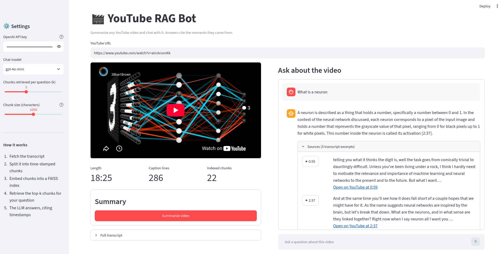
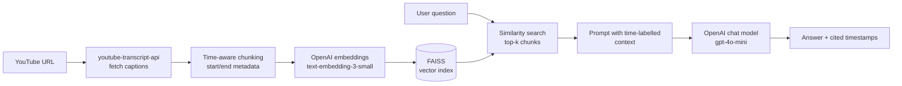

# 🎬 YouTube RAG Bot

**Chat with any YouTube video.** Paste a link, get a summary, and ask questions. Every answer cites the exact moments in the video it came from, and you can click a timestamp to jump the player there.

Built with **LangChain**, **OpenAI**, **FAISS** and **Streamlit** as a hands-on project in Retrieval-Augmented Generation (RAG).




## ✨ Features

- **Q&A over any video with a transcript.** Ask in plain English and get answers grounded only in what was said.
- **Cited, clickable sources.** Each answer lists the transcript excerpts it used, with ▶ buttons that seek the embedded player to that moment.
- **One-click summaries.** You get an overview paragraph plus key takeaways. Long videos are handled with map-reduce summarization.
- **Smart transcript loading.** The app prefers manual English captions, falls back to auto-generated ones, then to machine-translated English.
- **Tunable retrieval.** Change the chat model, chunk size and *k* from the sidebar and see how answers change.
- **Tested offline.** 35 tests (unit + Streamlit UI) use fake LLMs and embeddings, so they run in about a second with no API key and no cost.

## 🧠 How it works



1. **Load:** fetch the video's captions as timed segments.
2. **Chunk:** group consecutive captions into ~1,000-character chunks, with a small overlap, keeping each chunk's start and end time.
3. **Embed and index:** convert chunks to vectors and store them in an in-memory FAISS index (built once per video and cached).
4. **Retrieve:** embed the question and pull the *k* most similar chunks.
5. **Generate:** the LLM answers using only those chunks, each labelled like `[2:15-2:48]`, and cites the times it relied on.

## 🛠️ Design decisions

| Decision | Why |
|---|---|
| **Time-aware chunking** instead of a plain character splitter | Chunking on caption boundaries keeps exact start/end times, which powers the cited, clickable sources. |
| **Core logic separated from the UI** (`core/` vs `ytbot.py`) | The RAG pipeline is plain Python that can be tested, reused in a CLI or API, or moved to another UI. |
| **Dependency injection for the LLM and embeddings** | `VideoQA` accepts any LangChain chat model and embeddings. Tests pass in fakes; swapping providers is a one-line change. |
| **LCEL chains** (`prompt \| llm \| parser`) | LangChain's current composition style; the older `LLMChain` is deprecated. |
| **Grounding prompt with an "I don't know" rule** | Reduces hallucination: the model says when the transcript doesn't contain the answer. |
| **Map-reduce summaries** | Long transcripts are summarized in sections, then merged, so they never overflow the context window. |
| **Per-video index caching** | Embeddings are computed once per video and session, not on every question, saving time and API cost. |

## 📁 Project structure

```
youtube-rag-bot/
├── ytbot.py              # Streamlit UI
├── core/
│   ├── config.py         # Settings from env vars / .env
│   ├── transcript.py     # URL parsing, transcript fetching, time-aware chunking
│   ├── prompts.py        # Summary, combine and Q&A prompts
│   └── rag.py            # VideoQA: FAISS index, retrieval, answer & summarize
├── tests/                # Offline unit + UI tests (fake LLM + embeddings)
├── .github/workflows/    # CI: lint + tests on every push
├── .vscode/              # Run/debug configs, test discovery, formatter
├── Dockerfile
├── requirements.txt
└── requirements-dev.txt
```

## 🚀 Getting started

**Prerequisites:** Python 3.10+ and an [OpenAI API key](https://platform.openai.com/api-keys).

```bash
git clone https://github.com/ek-neize/youtube-rag-bot.git
cd youtube-rag-bot
python -m venv .venv
source .venv/bin/activate        # Windows: .venv\Scripts\activate
pip install -r requirements-dev.txt
cp .env.example .env             # then set OPENAI_API_KEY in .env
streamlit run ytbot.py
```

Then open http://localhost:8501. In VS Code you can also use **Run and Debug → Streamlit: ytbot**.

## 🧪 Tests and linting

```bash
pytest -q          # 35 tests, run offline in about a second
ruff check .       # lint
```

GitHub Actions runs both on every push and pull request.

## 🐳 Docker

```bash
docker build -t youtube-rag-bot .
docker run -p 8501:8501 --env-file .env youtube-rag-bot
```

## ⚙️ Configuration

| Variable | Default | Purpose |
|---|---|---|
| `OPENAI_API_KEY` | — | Required |
| `CHAT_MODEL` | `gpt-4o-mini` | Model for answers and summaries |
| `EMBEDDING_MODEL` | `text-embedding-3-small` | Model for embeddings |
| `CHUNK_SIZE` | `1000` | Target characters per chunk |
| `CHUNK_OVERLAP_SEGMENTS` | `2` | Caption lines shared between neighbouring chunks |
| `TOP_K` | `5` | Chunks retrieved per question |
| `MAX_SINGLE_PASS_CHARS` | `100000` | Above this, summaries use map-reduce |

## 🩺 Troubleshooting

| Problem | Fix |
|---|---|
| "Transcripts are disabled for this video" | The uploader turned captions off; try another video. |
| "YouTube is blocking transcript requests" | Common on cloud servers; run locally or configure a proxy. |
| `AuthenticationError` | Check `OPENAI_API_KEY` in `.env` or in the sidebar. |
| `ModuleNotFoundError: core` | Run commands from the project root with `.venv` activated. |

## 🗺️ Roadmap

- [ ] Conversational memory: rewrite follow-up questions using chat history
- [ ] Hybrid retrieval (BM25 + vectors) and re-ranking
- [ ] Persist FAISS indexes to disk so revisited videos skip embedding
- [ ] Stream answers token by token
- [ ] Multi-video and playlist search
- [ ] Retrieval evaluation set (hit rate / MRR) to tune chunk size and *k*

## 🙏 Acknowledgements

This project started from IBM's Skills Network guided project on building a YouTube summarizer with watsonx and Gradio. I rebuilt it with OpenAI and Streamlit and extended it with time-aware chunking, cited sources, tests and CI.

## 📄 License

[MIT](LICENSE) © 2026 Ekow Ashun
